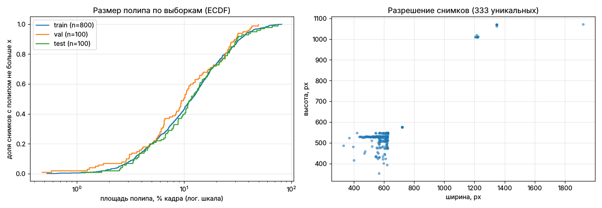

# Отчёт: сегментация полипов на снимках колоноскопии

Курсовой проект по компьютерному зрению, уровень «на 4»: модификация готовой сети.

## 1. Постановка задачи

**Задача:** бинарная семантическая сегментация. По снимку колоноскопии модель для каждого пикселя
предсказывает вероятность того, что он принадлежит полипу. Результат - маска полипа.

**Зачем:** полипы - предшественники колоректального рака. Часть полипов врач пропускает при осмотре,
особенно маленькие и плоские. Модель сегментации может подсвечивать подозрительные области в реальном
времени. В проекте решается учебная версия задачи на открытом датасете.

**Объект анализа:** отдельный снимок. **Гранулярность метрик:** снимок (метрика считается по каждому
снимку и усредняется).

## 2. Данные

### 2.1. Источник и формат

Kvasir-SEG (Jha et al., MMM 2020), официальный архив Simula Research Laboratory. 1000 снимков
колоноскопии с полипами и 1000 масок, размеченных специалистами. Маска - JPEG того же размера,
что и снимок (белый - полип). Из-за JPEG-сжатия маски бинаризуются по порогу 127.

### 2.2. Анализ данных

Статистика - `data/splits/dataset_stats.json`, график - `reports/figures/data_overview.png`.

| Характеристика | Значение | Следствие для решения |
|---|---|---|
| Снимков | 1000, в каждом есть полип | мало данных: нужен предобученный энкодер и аугментации |
| Разрешение | 333 разных, от 332x352 до 1920x1072, в основном около 620x530 | ресайз до 352x352 для обучения; метрики на test считаются в исходном разрешении |
| Площадь полипа | от 0.47% до 81% кадра, медиана 11.4%, 5-й перцентиль 2.5% | сильный дисбаланс «фон / полип» (мотивация для Dice + Focal); разброс масштаба в 170 раз (мотивация для ASPP) |
| Артефакты съёмки | восьмиугольная рамка эндоскопа, чёрный прямоугольник в левом нижнем углу у многих снимков, наложенный текст (дата, параметры), блики | возможные источники ложных срабатываний; проверяются в анализе ошибок |
| Дубликаты | 3 побайтовые копии и 1 пара соседних кадров | группы дубликатов не разрываются между выборками |

### 2.3. Разбиение

`scripts/prepare_data.py`, seed 42, доли 80/10/10, стратификация по размеру полипа (<5%, 5-20%, >20%
площади кадра). Состав выборок закоммичен (`data/splits/{train,val,test}.txt`), SHA-256 файлов -
в `data/splits/split_manifest.json` и в каждом эксперименте ClearML.

| Выборка | Снимков | <5% | 5-20% | >20% | Медиана площади |
|---|---|---|---|---|---|
| train | 800 | 160 | 428 | 212 | 11.8% |
| val | 100 | 20 | 53 | 27 | 9.9% |
| test | 100 | 20 | 53 | 27 | 11.6% |

**Поиск дубликатов.** Сначала пробовался pHash 8x8 по всему кадру. Он оказался непригоден: у совершенно
разных снимков расстояние Хэмминга 2-8, потому что хэш «видит» в основном одинаковую рамку эндоскопа
и чёрный угол (проверено визуально на парах). Итоговый способ - pHash 16x16 (256 бит) по центральным 60%
кадра. Распределение расстояний: 3 пары <= 6 (копии), 1 пара = 48 (соседние кадры одной сцены), дальше
разрыв до 62+ (разные снимки, проверено визуально). Порог 56. Все 4 пары попали в train целиком.

**Ограничение:** Kvasir-SEG не содержит идентификаторов пациентов и исследований. Разные снимки одного
полипа, снятые под разными углами, хэш не находит, поэтому полностью исключить утечку «по пациенту»
невозможно. Это может немного завышать метрики на val и test.

## 3. Метрики

Выбраны **до** экспериментов:

- **Основная - mDice на val** (Dice по каждому снимку, усреднённый по снимкам). Стандартная метрика
  сегментации полипов (используется в работах на Kvasir-SEG), напрямую измеряет перекрытие маски.
  Усреднение по снимкам, а не по пикселям всей выборки, нужно, чтобы маленький полип весил столько же,
  сколько крупный: при глобальном подсчёте ошибки на маленьких полипах «растворяются» в крупных,
  хотя клинически пропуск маленького полипа важнее.
- **Дополнительные:** mIoU (более строгая к ошибкам версия перекрытия, для сравнения с литературой),
  precision (доля предсказанной маски, которая действительно полип: ложные срабатывания),
  recall (доля полипа, которую модель нашла: пропуски), число провалов (Dice < 0.5) и Dice по группам
  размера полипа.
- **Accuracy по пикселям не используется:** при медианной площади полипа 11% модель, которая всегда
  отвечает «фон», получает около 89% accuracy.

Во время обучения метрики считаются на входе 352x352. Итоговая оценка (`polypseg.evaluate`) - в исходном
разрешении: логиты растягиваются до размера снимка и сравниваются с исходной маской.

## 4. Метод

### 4.1. Исходная модель

U-Net (`segmentation_models_pytorch` 0.5.0) с энкодером ResNet-34, предобученным на ImageNet. Декодер
из 5 блоков (каналы 256-128-64-32-16), в каждом upsample + конкатенация со skip-признаками энкодера +
2 свёртки 3x3. Выход - 1 канал логитов. Функция потерь - BCE. 24.44 млн параметров.

### 4.2. Модификации

| № | Тип по заданию | Модификация | Цель | Код |
|---|---|---|---|---|
| 1 | способ объединения признаков | **Attention Gates** на 4 skip-соединениях | Skip-признаки высокого разрешения содержат и полип, и похожий по текстуре фон (складки, блики). Gate умножает их на карту внимания α in [0,1], посчитанную с учётом сигнала с более грубого уровня декодера, который «знает» контекст. Ожидание: выше precision, меньше ложных срабатываний | `models/attention_gate.py`, `AttentionGatedUnetDecoder` в `models/factory.py` |
| 2 | функция потерь | **Dice + Focal** (γ=2) вместо BCE | Полип - в среднем 11% пикселей, в BCE доминирует лёгкий фон. Dice оптимизирует перекрытие напрямую и не зависит от доли фона; Focal снижает вклад уверенно классифицированных пикселей. Ожидание: выше Dice, особенно на маленьких полипах | `losses.py` |
| 3 | архитектурный блок | **ASPP** в bottleneck | Размер полипа меняется в 170 раз. Параллельные atrous-свёртки (dilation 1/2/4/6) и глобальный pooling дают признаки нескольких масштабов. Ожидание: лучше на крупных полипах и на краях диапазона размеров | `models/aspp.py` |

Attention Gate (Oktay et al., 2018): `α = σ(ψ(ReLU(θ(x) + φ(g))))`, выход `W(x · upsample(α))`, где
`x` - skip-признаки, `g` - выход предыдущего блока декодера, `θ` - свёртка 2x2 с шагом 2 (приводит `x`
к разрешению `g`), `φ, ψ, W` - свёртки 1x1. Блоки исходного декодера переиспользуются без изменений
(тест `test_modifications_extend_baseline` проверяет, что все веса исходной модели остаются на местах).

ASPP (DeepLabv3): ветки 1x1, три 3x3 с dilation 2/4/6 и image pooling, по 128 каналов; конкатенация ->
1x1 -> 512 каналов -> Dropout 0.1. **Отступление от статьи:** dilation 2/4/6 вместо 6/12/18, потому что
карта bottleneck при входе 352 имеет размер 11x11, и ядро с dilation 12-18 почти целиком попадает в паддинг.

### 4.3. Условия экспериментов

Одинаковы для всех вариантов (`configs/baseline.yaml`; конфиги вариантов отличаются только секциями
`model`/`loss`, что видно по `diff`):

| Параметр | Значение |
|---|---|
| Данные | одно и то же разбиение (SHA-256 файлов логируется в ClearML) |
| Вход | 352x352, нормализация ImageNet |
| Аугментации (train) | HorizontalFlip, VerticalFlip, RandomRotate90, Affine (масштаб 0.9-1.1, сдвиг 5%, поворот ±20°), ColorJitter |
| Оптимизатор | AdamW, lr 1e-4, weight decay 1e-4 |
| Расписание lr | cosine annealing до 1e-6 за 50 эпох |
| Batch / эпохи | 8 / 50 |
| Точность | AMP (float16), функции потерь считаются в float32 |
| Выбор эпохи | максимальный val mDice |
| Порог | 0.5 |
| Seed | 42 |

Полной побитовой воспроизводимости на GPU нет: cuDNN выбирает алгоритмы недетерминированно
(`cudnn.benchmark=True`). Поэтому при небольших различиях между вариантами (меньше ~1 п.п. val mDice
на 100 снимках) рекомендуется повторить запуск с `--seed 1` и `--seed 2`.

## 5. Эксперименты и результаты

Все запуски зарегистрированы в ClearML, проект *Kvasir-SEG polyp segmentation* (как смотреть - README,
раздел 7). Таблица ниже генерируется командой `docker compose run --rm compare` в
[`reports/experiments.md`](reports/experiments.md) по результатам обучения.

### 5.1. Сравнение вариантов на валидации

Сводная таблица: [`reports/experiments.md`](reports/experiments.md).

### 5.2. Кривые обучения

| Вариант | Loss и метрики train/val |
|---|---|
| baseline |  |
| attn_gates |  |
| dice_focal |  |
| aspp |  |

### 5.3. Выбор итоговой модели и оценка на test

Итоговая модель выбирается **только по val mDice** (`scripts/select_final.py`). Затем она один раз
оценивается на test (`docker compose run --rm evaluate`): метрики в
[`reports/test_eval/metrics.json`](reports/test_eval/metrics.json), поснимковые значения - в
`reports/test_eval/per_image.csv`.

## 6. Примеры предсказаний и анализ ошибок

Цвета на картах ошибок: зелёный - верно найденный полип (TP), красный - ложное срабатывание (FP),
синий - пропущенная часть полипа (FN).

**Лучшие предсказания на test:**

**Худшие предсказания на test:**

**Качество в зависимости от размера полипа:**

Анализ строится по `reports/test_eval/per_image.csv` и `metrics.json` (раздел `by_size`). Что проверяется:

1. **Размер полипа.** Сравнить mDice в группах <5%, 5-20%, >20%. На маленьких полипах ошибка в несколько
   пикселей границы сильно снижает Dice, а при ресайзе до 352 полип 0.5% кадра становится пятном
   примерно 25x25 пикселей.
2. **Тип ошибки у провалов (Dice < 0.5):** полный пропуск (`pred_area` = 0), ложное срабатывание
   рядом с полипом или «не тот объект» (маска в другом месте кадра).
3. **Артефакты съёмки** (гипотезы по результатам анализа данных): блики, складки слизистой,
   инструменты в кадре, чёрный прямоугольник в углу, наложенный текст.
4. **Граница полипа:** у плоских полипов граница размыта. Сравнить precision и recall: что преобладает,
   «расползание» маски или недосегментация.

## 7. Ограничения

- Мало данных (1000 снимков, 100 в test): доверительный интервал mDice на test - порядка нескольких
  процентных пунктов. Различия между вариантами меньше ~1 п.п. на val не стоит считать значимыми
  без повторов с другими seed.
- Нет разбиения по пациентам (в датасете нет этой информации), возможна частичная утечка через
  разные снимки одного полипа.
- Модель обучена только на снимках **с полипами**: на кадре без полипа она может что-то найти.
  Поведение на «пустых» кадрах не оценивалось, для клинического применения нужна такая проверка.
- Один источник данных (одно оборудование): на снимках другой клиники или эндоскопа качество может
  упасть. Проверить можно на внешнем датасете, например CVC-ClinicDB.
- Сервис работает на CPU (около 0.2 с на снимок в контейнере при проверке): для разбора видео в реальном
  времени нужен GPU или облегчённая модель.

## 8. Выводы

Выводы о том, какая модификация и почему улучшила или не улучшила mDice, формулируются по таблице
`reports/experiments.md` и анализу ошибок (раздел 6). Если ни одна модификация не улучшила val mDice,
в сравнении уже есть исходная модель и три обученных варианта с разными целями, как требует задание.
Тогда нужно обсудить, почему ожидаемый эффект не проявился: например, предобученный энкодер уже даёт
достаточно контекста, или Attention Gates требуют больше данных для обучения карты внимания.

## 9. Источники

1. Jha D. et al. Kvasir-SEG: A Segmented Polyp Dataset. MMM 2020.
2. Ronneberger O. et al. U-Net: Convolutional Networks for Biomedical Image Segmentation. [arXiv:1505.04597](https://arxiv.org/abs/1505.04597).
3. He K. et al. Deep Residual Learning for Image Recognition. [arXiv:1512.03385](https://arxiv.org/abs/1512.03385).
4. Oktay O. et al. Attention U-Net: Learning Where to Look for the Pancreas. [arXiv:1804.03999](https://arxiv.org/abs/1804.03999).
5. Chen L.-C. et al. Rethinking Atrous Convolution for Semantic Image Segmentation. [arXiv:1706.05587](https://arxiv.org/abs/1706.05587).
6. Lin T.-Y. et al. Focal Loss for Dense Object Detection. [arXiv:1708.02002](https://arxiv.org/abs/1708.02002).
7. Milletari F. et al. V-Net: Fully Convolutional Neural Networks for Volumetric Medical Image Segmentation. [arXiv:1606.04797](https://arxiv.org/abs/1606.04797).
8. Iakubovskii P. Segmentation Models Pytorch. <https://github.com/qubvel-org/segmentation_models.pytorch>.
